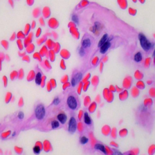
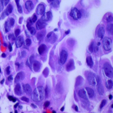
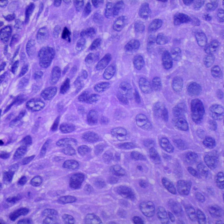
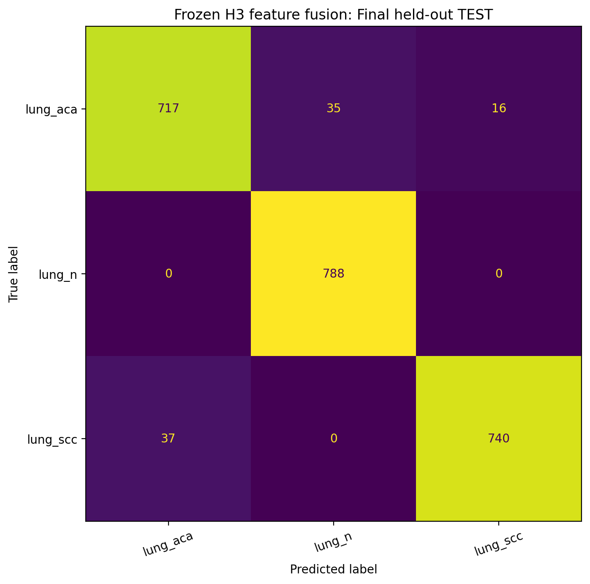
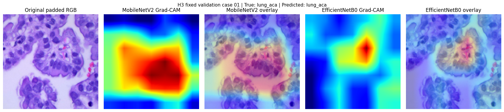
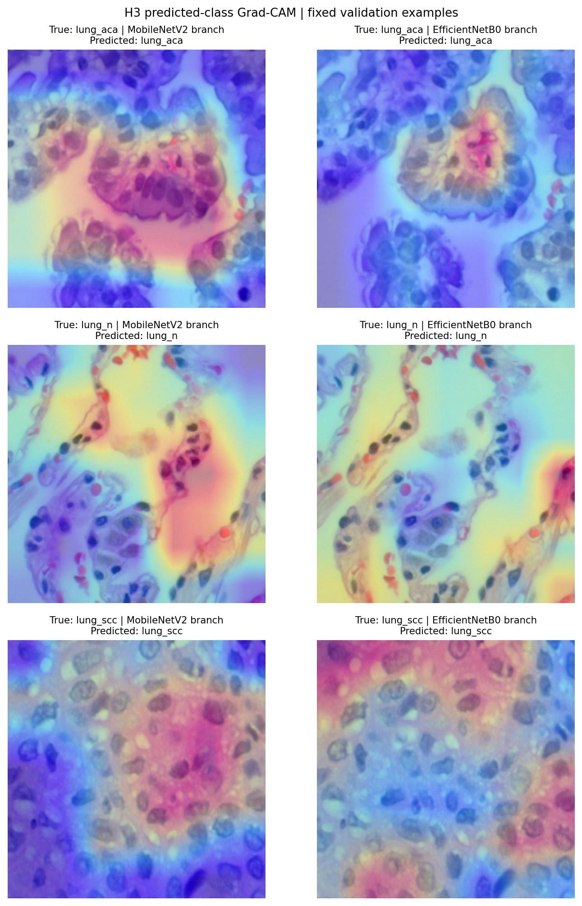

# Stain-Robust Explainable Deep Feature Fusion for Lung Histopathology Classification

[](https://www.python.org/)
[](https://tensorflow.org/)
[](https://keras.io/)
[](https://www.kaggle.com/datasets/andrewmvd/lung-and-colon-cancer-histopathological-images)
[]()
[]()

Undergraduate research project on three-class lung histopathology image classification using frozen ImageNet-pretrained backbones, pooled-feature concatenation, Reinhard stain normalization, H&E augmentation robustness analysis, and dual-branch Grad-CAM visual explainability.

**Author:** S M Sajjad Hossain Soykot  
**Supervisor:** Prof. Dr. Md. Zahidul Islam  
**Affiliation:** Department of Information and Communication Technology (ICT), Islamic University, Kushtia-7003, Bangladesh  
**Remote Repository:** [SajjadHossainSoykot/lung-histopathology-feature-fusion](https://github.com/SajjadHossainSoykot/lung-histopathology-feature-fusion)

---

> [!WARNING]
> **Medical and Educational Disclaimer:**  
> This project is designed strictly for academic, scientific, and educational research purposes. It implements automated histopathological pattern recognition, **not** clinical diagnosis, grading, or staging of lung cancer. The models have not been certified or validated in multi-center clinical trials or on real-world biopsy workflows across different staining protocols. Synthetic stain perturbations (H-up/E-down, H-down/E-up) evaluate mathematical sensitivity to color variance, but do **not** replace real cross-hospital, multi-scanner external validation. Softmax scores must not be interpreted as calibrated posterior diagnostic probabilities.

---

## Table of Contents

- [Overview and Key Objectives](#overview-and-key-objectives)
- [Dataset and Partitioning Scheme](#dataset-and-partitioning-scheme)
  - [Three-Class Taxonomy](#three-class-taxonomy)
  - [Source-Group-Separated Partitions](#source-group-separated-partitions)
  - [Class-by-Split Distribution](#class-by-split-distribution)
  - [Histopathological Sample Previews](#histopathological-sample-previews)
- [Methodology and Architecture](#methodology-and-architecture)
  - [Parallel Feature Extraction and Concatenation](#parallel-feature-extraction-and-concatenation)
  - [Preprocessing Pipeline](#preprocessing-pipeline)
  - [Model Architectures and Parameter Counts](#model-architectures-and-parameter-counts)
  - [Stain Normalization and Synthetic Shift Protocol](#stain-normalization-and-synthetic-shift-protocol)
  - [Dual-Branch Grad-CAM Explainability](#dual-branch-grad-cam-explainability)
- [Experimental Results](#experimental-results)
  - [Model Selection Benchmark (Validation Split)](#model-selection-benchmark-validation-split)
  - [Final Held-Out Test Evaluation (H3 Fusion Model)](#final-held-out-test-evaluation-h3-fusion-model)
  - [Per-Class Test Performance](#per-class-test-performance)
  - [Test Confusion Matrix](#test-confusion-matrix)
  - [Stain Robustness and Shift Resistance Benchmark](#stain-robustness-and-shift-resistance-benchmark)
- [Explainability and Visual Findings](#explainability-and-visual-findings)
  - [Dual-Branch Feature Attribution](#dual-branch-feature-attribution)
  - [Multi-Example Dual-Branch Panel](#multi-example-dual-branch-panel)
- [Repository Structure](#repository-structure)
- [Notebook Workflow and Reproducibility](#notebook-workflow-and-reproducibility)
  - [Environment Setup](#environment-setup)
  - [Notebook Directory Overview](#notebook-directory-overview)
  - [Cryptographic Verification Hashes](#cryptographic-verification-hashes)
- [Ethical Considerations and Limitations](#ethical-considerations-and-limitations)
- [Citation](#citation)

---

## Overview and Key Objectives

Accurate identification of lung cancer histological subtypes—specifically distinguishing adenocarcinoma, squamous cell carcinoma, and benign lung tissue—is essential for determining targeted oncological therapies. However, manual slide inspection is labor-intensive, subject to inter-observer variability, and vulnerable to staining protocol variations across histology laboratories.

This project investigates an automated, explainable transfer-learning and feature-fusion framework for lung histopathology classification:

1. **Source-Image-Group Separation:** Prevent data leakage across 15,000 lung histology images by grouping cropped tiles back to their **740 reconstructed source glass slides** (using `LC25000-clean`) across training, validation, and held-out test splits.
2. **Transfer Learning Backbones:** Compare frozen ImageNet-pretrained **MobileNetV2** (1,280 features) and **EfficientNetB0** (1,280 features) single-backbone baselines under identical group-separated conditions.
3. **Deep Pooled Feature Fusion:** Concatenate the two 1,280-dimensional feature representations into a unified 2,560-dimensional vector and train a lightweight classification head (7,683 trainable parameters) to leverage complementary morphological representations.
4. **Pre-Test Model Selection:** Formally select the superior architecture (H3) based strictly on validation metrics before ever exposing the held-out test split.
5. **Unbiased Generalization:** Evaluate the selected frozen model once on a held-out test set of **2,333 images** from **113 unseen source groups**.
6. **Stain Normalization & Robustness Analysis:** Study the impact of training-derived **Reinhard stain normalization** and H&E-inspired training augmentation against predetermined synthetic stain shifts ($H\uparrow/E\downarrow$ and $H\downarrow/E\uparrow$).
7. **Dual-Branch Explainability:** Produce simultaneous Gradient-weighted Class Activation Mapping (Grad-CAM) heatmaps from both MobileNetV2 (`out_relu`) and EfficientNetB0 (`top_activation`) convolutional backbones to inspect visual feature attribution.

---

## Dataset and Partitioning Scheme

The project utilizes the lung subset of the public **LC25000** dataset, consisting of **15,000 hematoxylin and eosin (H&E) stained histopathology images** across three diagnostic categories.

### Three-Class Taxonomy

| Class ID | Class Label | Meaning | Histological Description |
| :---: | :--- | :--- | :--- |
| **0** | `lung_aca` | Lung adenocarcinoma | Malignant epithelial tumor showing glandular differentiation or mucin production; disorganized alveolar architecture. |
| **1** | `lung_n` | Benign lung tissue | Normal non-neoplastic lung parenchyma; preserved alveolar spaces, delicate alveolar walls, and normal capillaries. |
| **2** | `lung_scc` | Lung squamous cell carcinoma | Malignant epithelial tumor exhibiting keratinization, intercellular bridges, and sheets of polygonal neoplastic cells. |

### Source-Group-Separated Partitions

In LC25000, 250 cropped tiles were extracted from each original glass slide. Random tile-level splitting creates severe data leakage. To ensure strict scientific validity, partitions were split at the **reconstructed source-image group level** (740 groups from `LC25000-clean`):

| Partition | Total Images | Reconstructed Groups | Percentage | Leakage Audit |
| :--- | :---: | :---: | :---: | :---: |
| **Training** | 10,394 | 514 | 69.29% | **0 groups overlap** |
| **Validation** | 2,273 | 113 | 15.15% | **0 groups overlap** |
| **Held-Out Test** | 2,333 | 113 | 15.55% | **0 groups overlap** |
| **Total** | **15,000** | **740** | **100.0%** | **Audited (`results/audit.json`)** |

### Class-by-Split Distribution

The full class breakdown across the frozen partitions is documented in [results/class_counts.csv](results/class_counts.csv):

| Class Name | Training Split | Validation Split | Test Split | Total Images |
| :--- | :---: | :---: | :---: | :---: |
| **Lung Adenocarcinoma (`lung_aca`)** | 3,474 | 758 | 768 | 5,000 |
| **Benign Lung Tissue (`lung_n`)** | 3,448 | 764 | 788 | 5,000 |
| **Lung Squamous Cell Carcinoma (`lung_scc`)** | 3,472 | 751 | 777 | 5,000 |
| **Total** | **10,394** | **2,273** | **2,333** | **15,000** |

The partition manifest is saved at [splits/manifest_candidate.csv](splits/manifest_candidate.csv), the class mapping at [splits/class_mapping.json](splits/class_mapping.json), and the group provenance mapping at [metadata/lc25000_image_groups.csv](metadata/lc25000_image_groups.csv).

### Histopathological Sample Previews

Pre-training sample previews from the training partition:

| Benign Lung (`lung_n`) | Adenocarcinoma (`lung_aca`) | Squamous Cell Carcinoma (`lung_scc`) |
| :---: | :---: | :---: |
|  |  |  |

---

## Methodology and Architecture

```text
                           Input Histopathology Image (224 × 224 × 3)
                                         │
                   ┌─────────────────────┴─────────────────────┐
                   ▼                                           ▼
         MobileNetV2 Scaling                        EfficientNetB0 Scaling
             ([-1, 1])                                     ([0, 255])
                   │                                           │
                   ▼                                           ▼
         MobileNetV2 Backbone                        EfficientNetB0 Backbone
      (ImageNet weights, Frozen)                  (ImageNet weights, Frozen)
                   │                                           │
        [Target: 'out_relu']                       [Target: 'top_activation']
                   │                                           │
                   ▼                                           ▼
         GlobalAveragePooling2D                      GlobalAveragePooling2D
          (1,280-dim vector)                          (1,280-dim vector)
                   │                                           │
                   └─────────────────────┬─────────────────────┘
                                         │
                                         ▼
                         Concatenate Pooled Features
                             (2,560-dim vector)
                                         │
                                         ▼
                              Dropout Layer (p = 0.2)
                                         │
                                         ▼
                            Dense Classification Head
                           (3 units, Softmax activation)
                                         │
                   ┌─────────────────────┴─────────────────────┐
                   ▼                                           ▼
       Predicted Class Probability                   Dual-Branch Grad-CAM
   (lung_aca / lung_n / lung_scc)                   Validation Heatmap Overlays
```

### Parallel Feature Extraction and Concatenation
- The H3 fusion architecture feeds input images simultaneously into two frozen ImageNet-pretrained backbones:
  - **MobileNetV2:** Inverted residual blocks capture fine structural and edge features.
  - **EfficientNetB0:** Compound-scaled depthwise separable convolutions capture multi-scale tissue context.
- Each branch outputs a 1,280-dimensional feature vector via `GlobalAveragePooling2D`.
- Vectors are concatenated into a **2,560-dimensional fused feature representation**.
- A classification head with `Dropout(0.2)` and a `Dense(3, softmax)` layer maps the fused representation to class probabilities.

### Preprocessing Pipeline
- Images are resized to **224 × 224 × 3** with `float32` precision.
- **Model-Native Preprocessing:** Handled internally per branch inside the full-image model:
  - MobileNetV2 branch: Rescaling from $[0, 255]$ to $[-1, 1]$.
  - EfficientNetB0 branch: Model-native normalization layer preserving $[0, 255]$ inputs.

### Model Architectures and Parameter Counts

| Model Architecture | Trainable Params | Non-Trainable Params | Total Parameters | Model Size |
| :--- | :---: | :---: | :---: | :---: |
| **H1: MobileNetV2 Baseline** | 3,843 | 2,257,984 | 2,269,515 | ~8.66 MB |
| **H2: EfficientNetB0 Baseline** | 3,843 | 4,049,571 | 4,061,102 | ~15.49 MB |
| **H3: Deep Feature Fusion (Head)** | 7,683 | 0 | 23,051 | ~90.05 KB |
| **H3: Deep Feature Fusion (Full Image)** | 7,683 | 6,307,555 | **6,315,238** | ~24.09 MB |

### Stain Normalization and Synthetic Shift Protocol
In experiment H4, the impact of stain variance was evaluated using:
1. **Reinhard Normalization (H4-N):** Images are converted to Lab color space and aligned with reference mean and standard deviation statistics fitted strictly on the training partition.
2. **H&E-Inspired Augmentation (H4-NA):** Color variations simulated in optical density (OD) space during feature caching.
3. **Synthetic Stain Shifts:** Two predetermined shift conditions applied to the clean validation set:
   - **$H\uparrow/E\downarrow$:** Increased Hematoxylin (hyperchromatic basophilic shift) with attenuated Eosin.
   - **$H\downarrow/E\uparrow$:** Attenuated Hematoxylin with intensified Eosin (eosinophilic shift).

### Dual-Branch Grad-CAM Explainability
- Explainability is computed for both branches with respect to the **same predicted-class logit** in the trained H3 head.
- **MobileNetV2 target layer:** `out_relu` (penultimate $7 \times 7$ activation map).
- **EfficientNetB0 target layer:** `top_activation` (penultimate $7 \times 7$ activation map).

---

## Experimental Results

### Model Selection Benchmark (Validation Split)

All models were evaluated on the identical 2,273-image validation split (from 113 disjoint source groups):

| Experiment | Model Description | Validation Accuracy | Validation Macro-F1 | Validation Loss | Best Epoch |
| :--- | :--- | :---: | :---: | :---: | :---: |
| **H1** | Frozen MobileNetV2 | 97.0963% | 0.970826 | 0.0782 | Epoch 3 |
| **H2** | Frozen EfficientNetB0 | 97.2283% | 0.972158 | 0.0703 | Epoch 6 |
| **H3** | **Pooled Feature Fusion (Selected)** | **98.0202%** | **0.980139** | **0.0487** | **Epoch 5** |
| **H4-N** | Reinhard Stain Normalized Fusion | 97.2723% | 0.972577 | 0.0734 | Epoch 6 |
| **H4-NA** | Reinhard + H&E Augmentation Fusion | 97.1403% | 0.971261 | 0.0776 | Epoch 6 |

**Model Selection Rationale:**  
**H3 Deep Feature Fusion** achieved the highest validation accuracy (**98.02%**) and Macro-F1 (**0.9801**), outperforming both single-backbone baselines and stain-normalized variants. H3 reduced validation classification errors from 66 (H1) and 63 (H2) down to 45. In accordance with the pre-registered protocol, H3 was **formally frozen** as the final model before the held-out test split was accessed.

---

### Final Held-Out Test Evaluation (H3 Fusion Model)

The frozen H3 model was evaluated **exactly once** on the **2,333 held-out test images** (from 113 unseen source groups). No hyperparameter tuning or architectural modifications were performed after test evaluation.

| Overall Test Metric | Result |
| :--- | :---: |
| **Test Accuracy** | **96.2280% (2,245 / 2,333 correct, 88 errors)** |
| **Test Macro-F1 Score** | **0.961961** |
| **Test Macro-Precision** | **0.962412** |
| **Test Macro-Recall** | **0.961992** |
| **Test Weighted-F1 Score** | **0.962114** |

### Per-Class Test Performance

Detailed breakdown from [results/H_Final_Test_H3_seed42/test_classification_report.csv](results/H_Final_Test_H3_seed42/test_classification_report.csv):

| Class Label | Precision | Recall | F1-Score | Support (Test Images) |
| :--- | :---: | :---: | :---: | :---: |
| **Lung Adenocarcinoma (`lung_aca`)** | 0.9509 | 0.9336 | 0.9422 | 768 |
| **Benign Lung Tissue (`lung_n`)** | 0.9575 | **1.0000** | **0.9783** | 788 |
| **Lung Squamous Cell Carcinoma (`lung_scc`)** | **0.9788** | 0.9524 | 0.9654 | 777 |
| **Macro Average** | **0.9624** | **0.9620** | **0.9620** | **2,333** |
| **Weighted Average** | **0.9624** | **0.9623** | **0.9621** | **2,333** |

Key observations:
- **Flawless Benign Sensitivity:** The model achieved **100% recall** on `lung_n` (788/788 correct), with zero false negatives on normal tissue.
- **High Carcinoma Discrimination:** Squamous cell carcinoma demonstrated 97.88% precision, effectively discriminating dense keratinized epithelial sheets.
- **Primary Error Source:** Mutual boundary ambiguity between adenocarcinoma and squamous cell carcinoma (37 SCC misclassified as ACA; 19 ACA misclassified as SCC).

### Test Confusion Matrix

Below is the normalized confusion matrix across all 2,333 held-out test scans:



### Stain Robustness and Shift Resistance Benchmark

Performance under synthetic color perturbations on the validation partition (from [results/H4_Reinhard_HE_Aug_Robustness_seed42/validation_robustness_summary.csv](results/H4_Reinhard_HE_Aug_Robustness_seed42/validation_robustness_summary.csv)):

| Model Condition | Clean Macro-F1 | $H\uparrow/E\downarrow$ Macro-F1 | $H\downarrow/E\uparrow$ Macro-F1 | Mean Shifted Macro-F1 | Mean Drop from Clean |
| :--- | :---: | :---: | :---: | :---: | :---: |
| **H3 Original (Fusion)** | **0.980139** | **0.976148** | **0.971283** | **0.973715** | 0.006423 |
| **H4-N (Reinhard)** | 0.972577 | 0.969955 | 0.968144 | 0.969050 | 0.003527 |
| **H4-NA (Reinhard + HE Aug)** | 0.971261 | 0.970407 | 0.969954 | 0.970180 | **0.001081** |

> [!NOTE]
> **Takeaway on Robustness:** While H4-NA exhibited the highest stability (smallest relative drop of 0.00108 under synthetic shifts), **H3 Original retained the highest absolute performance** across both clean (0.9801) and shifted conditions (0.9761 and 0.9713).

---

## Explainability and Visual Findings

### Dual-Branch Feature Attribution
Dual-branch Grad-CAM visualizes the convolutional features that contributed most strongly to the fused classification decision:
- **MobileNetV2 Branch (`out_relu`):** Tends to focus on localized cellular boundaries, chromatin density, and nuclear atypia.
- **EfficientNetB0 Branch (`top_activation`):** Tends to capture broader architectural patterns, including glandular lumens in adenocarcinoma and dense solid epithelial sheets in squamous carcinoma.

### Qualitative Validation Heatmap Example



### Multi-Example Dual-Branch Panel

The panel below displays dual-branch Grad-CAM comparisons across the six preselected validation cases (2 per class):



Individual branch panels are archived in [results/H_GradCAM_H3_validation_seed42/panels/](results/H_GradCAM_H3_validation_seed42/panels/).

---

## Repository Structure

```text
lung-histopathology-feature-fusion/
├── README.md                                 # Comprehensive project documentation
├── requirements.txt                          # Exact environment dependencies
├── .gitignore                                # Excludes raw slides and heavy weights
│
├── docs/                                     # Research & provenance documentation
│   ├── ARTIFACTS.md                          # Manifest of generated files and checkpoints
│   ├── DATASET_AND_SPLITS.md                 # Split counts, group hashes, and leakage audit
│   ├── LIMITATIONS.md                        # Methodological and clinical boundaries
│   ├── NOTEBOOK_PROVENANCE.md                # Environment and execution metadata
│   ├── REPRODUCIBILITY.md                    # Environment details & execution records
│   └── RESULTS.md                            # Comprehensive experiment metrics & tables
│
├── metadata/                                 # Dataset source annotations
│   └── lc25000_image_groups.csv              # Source slide groupings (15,000 tiles -> 740 groups)
│
├── splits/                                   # Audited group-level partitions
│   ├── class_mapping.json                    # Fixed class-to-index mapping dictionary
│   └── manifest_candidate.csv                # Complete partition assignments (15,000 rows)
│
├── notebooks/                                # Jupyter execution records
│   ├── 00_Lung_Setup_and_Data_Checks.ipynb   # Split verification & data integrity check
│   ├── H1_Lung_MobileNetV2_Baseline.ipynb    # Training & validation of MobileNetV2
│   ├── H2_Lung_EfficientNetB0_Baseline.ipynb # Training & validation of EfficientNetB0
│   ├── H3_Lung_Deep_Feature_Fusion.ipynb     # Feature concatenation, head training & fusion
│   ├── H4_Lung_Stain_Normalization_Augmentation_Robustness.ipynb # Reinhard & shift evaluation
│   ├── H_GradCAM_H3_Deep_Feature_Fusion.ipynb # Dual-branch Grad-CAM generation
│   └── H_Final_Test_H3_Deep_Feature_Fusion.ipynb # One-time final held-out test evaluation
│
├── report/                                   # Formal report tracking
│   └── README.md                             # Report source status
│
└── results/                                  # Complete experimental artifacts & reports
    ├── audit.json                            # Automated partition audit validation report
    ├── class_counts.csv                      # Class distribution per split summary
    ├── figures/                              # Standalone publication-ready figures
    │   ├── H1_validation_confusion_matrix.png
    │   ├── H2_validation_confusion_matrix.png
    │   ├── H3_validation_confusion_matrix.png
    │   ├── H3_training_loss.png
    │   ├── H3_GradCAM_validation_example.png
    │   └── H4_synthetic_shift_macro_F1_validation.png
    ├── tables/                               # Consolidated experimental tables
    │   ├── validation_model_comparison.csv
    │   ├── h3_clean_validation_confusion_matrix.csv
    │   ├── h4_synthetic_shift_validation.csv
    │   └── final_test_selected_h3.csv
    ├── training_previews/                    # Pre-training sample histology previews
    ├── H1_MobileNetV2_frozen_seed42/         # H1 training curves & validation metrics
    ├── H2_EfficientNetB0_frozen_seed42/      # H2 training curves, validation & comparison
    ├── H3_MobileNetV2_EfficientNetB0_fusion_seed42/ # H3 training curves & fusion model summaries
    ├── H4_Reinhard_HE_Aug_Robustness_seed42/ # H4 robustness metrics under synthetic shifts
    ├── H_GradCAM_H3_validation_seed42/       # Grad-CAM branch panels (6 cases) & overview
    └── H_Final_Test_H3_seed42/               # Final held-out test metrics, report & matrix
```

---

## Notebook Workflow and Reproducibility

### Environment Setup

Clone the repository and install dependencies in a clean virtual environment:

```bash
# Clone the repository
git clone https://github.com/SajjadHossainSoykot/lung-histopathology-feature-fusion.git
cd lung-histopathology-feature-fusion

# Create and activate virtual environment
python3 -m venv .venv
source .venv/bin/activate   # On Windows: .venv\Scripts\activate

# Install required packages
pip install --upgrade pip
pip install -r requirements.txt
```

### Notebook Directory Overview

The notebooks under `notebooks/` preserve the historical Google Colab execution records:

| Notebook | Purpose | Status |
| :--- | :--- | :---: |
| [`00_Lung_Setup_and_Data_Checks.ipynb`](notebooks/00_Lung_Setup_and_Data_Checks.ipynb) | Dataset recovery, directory creation, and manifest verification. | Utility |
| [`H1_Lung_MobileNetV2_Baseline.ipynb`](notebooks/H1_Lung_MobileNetV2_Baseline.ipynb) | Trains frozen MobileNetV2, generates loss curves, evaluates validation set. | Executed |
| [`H2_Lung_EfficientNetB0_Baseline.ipynb`](notebooks/H2_Lung_EfficientNetB0_Baseline.ipynb) | Trains frozen EfficientNetB0, evaluates validation set, generates comparison. | Executed |
| [`H3_Lung_Deep_Feature_Fusion.ipynb`](notebooks/H3_Lung_Deep_Feature_Fusion.ipynb) | Extracts pooled features, concatenates representations, trains fusion head. | Executed |
| [`H4_Lung_Stain_Normalization_Augmentation_Robustness.ipynb`](notebooks/H4_Lung_Stain_Normalization_Augmentation_Robustness.ipynb) | Evaluates Reinhard normalization and H&E augmentation under synthetic shifts. | Executed |
| [`H_GradCAM_H3_Deep_Feature_Fusion.ipynb`](notebooks/H_GradCAM_H3_Deep_Feature_Fusion.ipynb) | Computes dual-branch Grad-CAM activations on preselected validation cases. | Executed |
| [`H_Final_Test_H3_Deep_Feature_Fusion.ipynb`](notebooks/H_Final_Test_H3_Deep_Feature_Fusion.ipynb) | Executes one-time final test evaluation on the 2,333 held-out test scans. | Executed |

> [!NOTE]
> The executed notebooks reference `/content/drive/MyDrive/ICTIU_Final_Projects/lung/` where raw histology tiles, generated feature caches, and model checkpoints (`best_head.keras`) were persisted during Colab runs.

### Cryptographic Verification Hashes

To verify the integrity of the data partitions and historical runs, compare the following SHA-256 checksums:

| File / Component | SHA-256 Checksum |
| :--- | :--- |
| `splits/manifest_candidate.csv` | `d931c9b11d03716c3c426f251bc75eaa2051002acca99d3ba66d59d964285dea` |
| `splits/class_mapping.json` | `4d14782118e3a438c13b209d7a594f2f9676d09cec25125b599d8c6d6c26a6a8` |
| `metadata/lc25000_image_groups.csv` | `2ff9e992f759f265dfc9aa2363de0dfcc8e6559884d8bb02a4c925214fdf7e23` |
| `results/audit.json` | `cd9aecfb8bfe64ca956b205e333ce9c9697dbfa88d4c46dc89c3ac088115fac0` |
| H1 Checkpoint (`best_model.keras`) | `503559b9333124d8be0b665a9fd9538220a750db2274ca55a9e61dff503dd6bf` |
| H2 Checkpoint (`best_model.keras`) | `fcd95f3198c1a63641462b3a72e6b21cf501a4ad0928186bd91c2362c53fa5f6` |
| H3 Checkpoint (`best_head.keras`) | `77deea98faef81db0fd8e6574598f677a18f9368fde3edccc67c3549b5098b75` |
| H3 Test Predictions (`test_predictions.csv`) | `e23a916af52db9b5e53a172aac94efbe7b10578e110379421796a341e65b39d6` |
| `00_Lung_Setup_and_Data_Checks.ipynb` | `79cceafda7f48ce039d8b5d9827b29067aed5655e7ddb31dfc13457847b28dd0` |
| `H1_Lung_MobileNetV2_Baseline.ipynb` | `ef3b600c720d4533740ff2d6370c947d0c309e5a01f877fc93be3b9251595c96` |
| `H2_Lung_EfficientNetB0_Baseline.ipynb` | `c1779f0f776b0a8d1c9075b4c08d9fb5ed3d80052e1ac91b83e0d16e6b9446b9` |
| `H3_Lung_Deep_Feature_Fusion.ipynb` | `6a0c35492b1474fbdc896571e77f3f5b4602c3a81d8d7e1d3976d63e15460efc` |
| `H4_Lung_Stain_Normalization_Augmentation_Robustness.ipynb` | `884e159367422faeff9a5289736591c3ed3bf67135b5199e2328f8335204ec16` |
| `H_GradCAM_H3_Deep_Feature_Fusion.ipynb` | `6208748dfdbdd9f8e250245d5fe349538e58c35e6ca9e98e6131a0488297e5b6` |
| `H_Final_Test_H3_Deep_Feature_Fusion.ipynb` | `4d9844af57e242317832ead573cb12eff4d9330508c41039dfd96807a737d034` |

---

## Ethical Considerations and Limitations

1. **Dataset Origin:** Derived from the lung subset of LC25000 (750 original glass slide fields of view). The source-image-group separation resolves tile duplication leakage, but cannot guarantee patient-level independence.
2. **Pretrained Features:** Backbones were pretrained on natural images (ImageNet-1k). While effective, they were not pretrained with histopathology-specific self-supervised algorithms.
3. **Stain Shift Generalization:** Mathematical perturbations ($H\uparrow/E\downarrow$ and $H\downarrow/E\uparrow$) simulate illumination and dye variance, but do not reproduce the complex multi-site slide preparation artifacts found across clinical pathology laboratories.
4. **Interpretability Scope:** Grad-CAM heatmaps highlight feature attribution in the neural network; they do not represent diagnostic proof, clinical cell segmentations, or margin boundaries.

---

## Citation

If you use or reference this work in your research, please cite:

```bibtex
@misc{soykot2026lunghistopathology,
  author       = {S M Sajjad Hossain Soykot and Md. Zahidul Islam},
  title        = {Stain-Robust Explainable Deep Feature Fusion for Lung Histopathology Classification},
  year         = {2026},
  publisher    = {GitHub},
  howpublished = {\url{https://github.com/SajjadHossainSoykot/lung-histopathology-feature-fusion}},
  note         = {Undergraduate Research Project, Dept. of Information and Communication Technology, Islamic University, Bangladesh}
}
```
